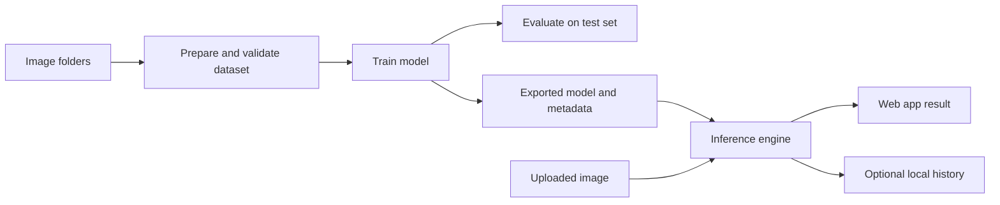

# Textile Defect Detection

A computer-vision tool that looks at a fabric or garment image and says which defect class it most likely shows. It runs locally on a normal Windows laptop. No GPU is needed.

## Overview

Textile Defect Detection helps with image-based fabric and garment inspection. A user uploads a photo. The system checks the image, runs a trained model, and shows the most likely class with a confidence score for every class.

It is an inspection-assistance tool. It does not replace a qualified inspector and it does not accept or reject goods.

The repository also contains everything needed to prepare a dataset, train a model, test it fairly, and run it in a simple web page on your own computer.

## Industrial Problem

Fabric and garments are checked for defects such as holes, stains, broken lines or yarn faults. Today this is mostly done by people looking at the material.

Visual checking is hard to keep consistent:

- Attention drops during long shifts.
- Different inspectors may judge the same flaw differently.
- Results are often not recorded in a way that is easy to review later.

A software tool can give a steady second opinion and a written record. To be useful, it must also be tested honestly on real images from the same kind of fabric, camera and lighting that will be used in practice.

## Proposed Solution

The project trains an image classifier. A classifier is a program that learns from labelled example images, then labels new images by itself.

The workflow is built to be careful and traceable:

- Images are checked before use. Broken or unsafe files are rejected.
- Training and testing images are kept apart. This stops the model from being "tested" on pictures it has already seen.
- Every trained model is saved with its class list, its settings and a checksum, so the right model is always used with the right labels.
- Results below a set confidence level are marked "review required". They are never shown as "no defect".

## Key Capabilities

These are implemented in the current code.

- **Dataset preparation.** Builds a file list from folders of images and splits it into training, validation and test sets. Images that belong to the same fabric sample stay together in one set.
- **Dataset checks.** Finds missing or damaged files, wrong labels, duplicate images and possible leakage between sets.
- **Training.** Trains a ResNet-18 classifier using a pretrained starting point, on CPU or on Google Colab.
- **Evaluation.** Reports accuracy, precision, recall, F1 score, support and a confusion matrix. Writes JSON, Markdown and per-image CSV reports.
- **Web app.** Upload an image, preview it, analyze it, and see the predicted class and all class scores.
- **Optional local history.** Saves results (never the images) to a local database. Results can be exported as CSV or JSON.
- **Google Colab notebook.** Runs the same pipeline on a free GPU when one is available.

## How It Works

**Input → Process → Output**

1. **Input.** The user uploads a JPG, PNG or WebP image.
2. **Process.** The app checks the file, resizes the image the way the model expects, and runs the model.
3. **Output.** The user sees the predicted class, a score for every class, the model name and the processing time.

Scores are not exact probabilities. A high score means the model is more sure, not that it is correct.

Typical use:

1. Start the app.
2. Choose an image of a fabric piece.
3. Press **Analyze image**.
4. Read the result. If it says "review required", check the fabric by eye.

## System Architecture



Main parts:

- **Dataset tools** prepare and check the data.
- **Training and evaluation** build and test the model. These need PyTorch.
- **Inference engine** loads an exported model and turns an image into a result.
- **Web app** (Streamlit) shows the interface. It contains no model logic.
- **Workflow layer** connects the app to the engine and the optional history. It can be tested without the web app.

## Technology Stack

| Technology | Purpose |
|---|---|
| Python 3.10 to 3.12 | Main language (tested with 3.12) |
| PyTorch and torchvision | Model and training (ResNet-18) |
| Pillow and NumPy | Image checking, resizing and augmentation |
| scikit-learn | Used in tests to cross-check the metrics |
| Streamlit | Local web interface |
| SQLite | Optional local result history |
| PyYAML | Configuration files |
| pytest and ruff | Testing and code checks |
| Google Colab | Optional GPU training |

## Installation & Setup

### Prerequisites

- Windows 10 or 11
- Python 3.12 (or 3.10 / 3.11) from [python.org](https://www.python.org/downloads/), added to PATH
- An internet connection for installation, and once for the pretrained ResNet-18 weights during real training
- Git, only if you want to publish the project

### Install

Open a terminal in the project folder.

**PowerShell**

```powershell
py -3.12 -m venv .venv
Set-ExecutionPolicy -Scope Process -ExecutionPolicy Bypass
.venv\Scripts\Activate.ps1
python -m pip install --upgrade pip
pip install --default-timeout=100 --retries 10 -r requirements-dev.txt
pip install -e .
```

**Command Prompt**

```bat
py -3.12 -m venv .venv
.venv\Scripts\activate.bat
python -m pip install --upgrade pip
pip install --default-timeout=100 --retries 10 -r requirements-dev.txt
pip install -e .
```

Your prompt should start with `(.venv)`. Repeat the activation command in every new terminal window.

If the default `py` version is newer than 3.12, always use `py -3.12` as shown.

### Check the installation

```powershell
python -m pytest -q
```

### Configuration

- `configs/inference.yaml` sets the model files, input limits, confidence threshold and history database.
- `configs/training.yaml` sets dataset paths, image processing, augmentation and training options.
- `configs/training_synthetic_smoke.yaml` is a small configuration for the generated demo data.

Unknown settings are rejected, so spelling mistakes are caught. Relative paths are relative to the project folder.

The default confidence threshold of 0.5 is a placeholder. Choose your own value from validation results, not from the test set.

### Start the application

```powershell
python -m streamlit run app.py
```

Open the address shown, usually `http://localhost:8501`. The app needs an exported model in the `models` folder. Without one it shows "Model unavailable" and does not produce predictions.

## Usage

### Try the full pipeline with generated demo data

The demo images are **synthetic**. They are generated by the project and are not real textiles. The demo only shows that the software works. A model trained on it says nothing about real defects.

```powershell
python scripts\make_synthetic_fixture.py --out data\synthetic_demo --images-per-class 24
python scripts\prepare_dataset.py --source-root data\synthetic_demo --output-dir data\processed\synthetic_demo --group-regex "_(g\d+)_"
python scripts\validate_dataset.py --manifest data\processed\synthetic_demo\samples.csv --images-root data\synthetic_demo
python scripts\train.py --config configs\training_synthetic_smoke.yaml
```

`train.py` prints an experiment folder such as `outputs\experiments\<EXPERIMENT>`. Use its name below.

```powershell
python scripts\evaluate.py --model-dir outputs\experiments\<EXPERIMENT>\model --manifest data\processed\synthetic_demo\samples.csv --images-root data\synthetic_demo --split test
python scripts\export_model.py --model-dir outputs\experiments\<EXPERIMENT>\model
python -m streamlit run app.py
```

### Use a real dataset

1. Choose a dataset and read its licence. See [docs/DATASETS.md](docs/DATASETS.md). The project does not download data for you.
2. Place images in `data\raw\<name>\<class>\image.png`. For an official split, use `train`, `val` and `test` folders and add `--layout split-folders` when preparing.
3. Add `data\raw\<name>\dataset_info.json` with the real source, licence and citation. A template is in [data/README.md](data/README.md).
4. Prepare and validate the data. Use `--group-regex` to read the sample or session ID from file names so related images stay together.
5. Copy `configs\training.yaml`, set the dataset paths, and train with `python scripts\train.py --config <your file>` or use the Colab notebook.
6. Choose settings using validation results only.
7. Evaluate the test set once, when all decisions are final. The report warns if a split was evaluated before.
8. Export the model and start the app.

`validate_dataset.py` returns exit code 1 when it finds confirmed errors. Warnings, such as visually similar images, need a manual review.

### Use the app

- Upload an image and press **Analyze image**. Use **Clear image** to start again.
- A result below the confidence threshold is marked "review required".
- Tick **Save results to local history** in the sidebar to keep results. Images are never saved.
- Open **Inspection history and export** to filter results and download CSV or JSON.

### Google Colab

Open `notebooks/textile_defect_training.ipynb` in Colab, upload the project ZIP, and run the cells in order. Colab limits can change, so check Google's current rules.

## Project Structure

```text
app.py                      Streamlit web app (interface only)
src/textile_defect_detection/
    image_processing.py     Image checks, resizing, augmentation
    dataset.py, splits.py   File lists, class mapping, group-aware splits
    dataset_validation.py   Dataset and leakage checks
    model.py, training.py   ResNet-18 model and training (PyTorch)
    model_metadata.py       Class list, settings and checksum saved with a model
    inference.py            Loads a model and analyzes an image
    predictions.py          Scores, confidence threshold, result format
    metrics.py, evaluation.py   Metrics and evaluation reports
    inspection_store.py, export.py   Optional history and CSV/JSON export
    workflow.py             Logic between the app and the engine
    synthetic.py            Generator for the demo data
scripts/                    Command-line tools (prepare, validate, train, evaluate, export)
configs/                    YAML settings
notebooks/                  Google Colab training notebook
tests/                      Automated tests
docs/                       Dataset notes, spec notes, UI checklist, publishing guide
data/, models/, outputs/    Local data, exported models and results (not committed)
```

## Current Status

**Implemented and checked**

- Dataset tools, splitting, validation, metrics, evaluation reports, history and export. These have automated tests.
- The automated test suite, including the PyTorch tests, passes on Windows with Python 3.12.
- The full pipeline (prepare, validate, train, evaluate) has run on the generated demo data on Windows.
- The web app starts on Windows and correctly shows "Model unavailable" when no model is exported.

**Not yet verified**

- The complete upload-and-analyze flow in the app with an exported model. A manual checklist is in [docs/MANUAL_UI_CHECKLIST.md](docs/MANUAL_UI_CHECKLIST.md).
- The Colab notebook has not been run.
- No real textile dataset has been used.

**Not available**

- No trained model is included.
- There are no accuracy results on real fabric or garment images.
- The tool has not been tested in a factory.

**Known limits**

- It labels a whole image. It does not show where the defect is, and it does not measure size or severity.
- It only knows the classes it was trained on. An unfamiliar defect will be forced into one of them.
- Very wide images, such as long fabric strips, lose much of their content with the default centre crop. A `squash` option exists. Splitting images into tiles is not implemented.
- Results on a public dataset do not predict results on your production line.

[docs/VERIFICATION_REPORT.md](docs/VERIFICATION_REPORT.md) records the checks made when the project was first built in an environment where PyTorch could not be installed. The PyTorch tests have since passed on Windows.

## Roadmap

These items are planned. None of them is implemented.

- Evaluate on a verified, licensed textile dataset and publish the real results.
- Split wide fabric images into tiles.
- Locate defects with boxes or masks. This needs annotated data.
- Choose and check the confidence threshold using validation data.
- Add live camera input.

## Contributing

1. Fork the repository and install it as shown above.
2. Run `python -m pytest -q` before and after your change.
3. Keep interface code, logic code and PyTorch code separate.
4. Do not add fake predictions or placeholder results. Label synthetic data clearly.
5. Do not tune settings against the test set.
6. Do not commit datasets, model files, databases or credentials.

More detail is in [CONTRIBUTING.md](CONTRIBUTING.md).

## License

The source code is released under the MIT License. See [LICENSE](LICENSE).

The license covers this repository's code only. Datasets and pretrained weights have their own terms. Check them before you use or share them.
